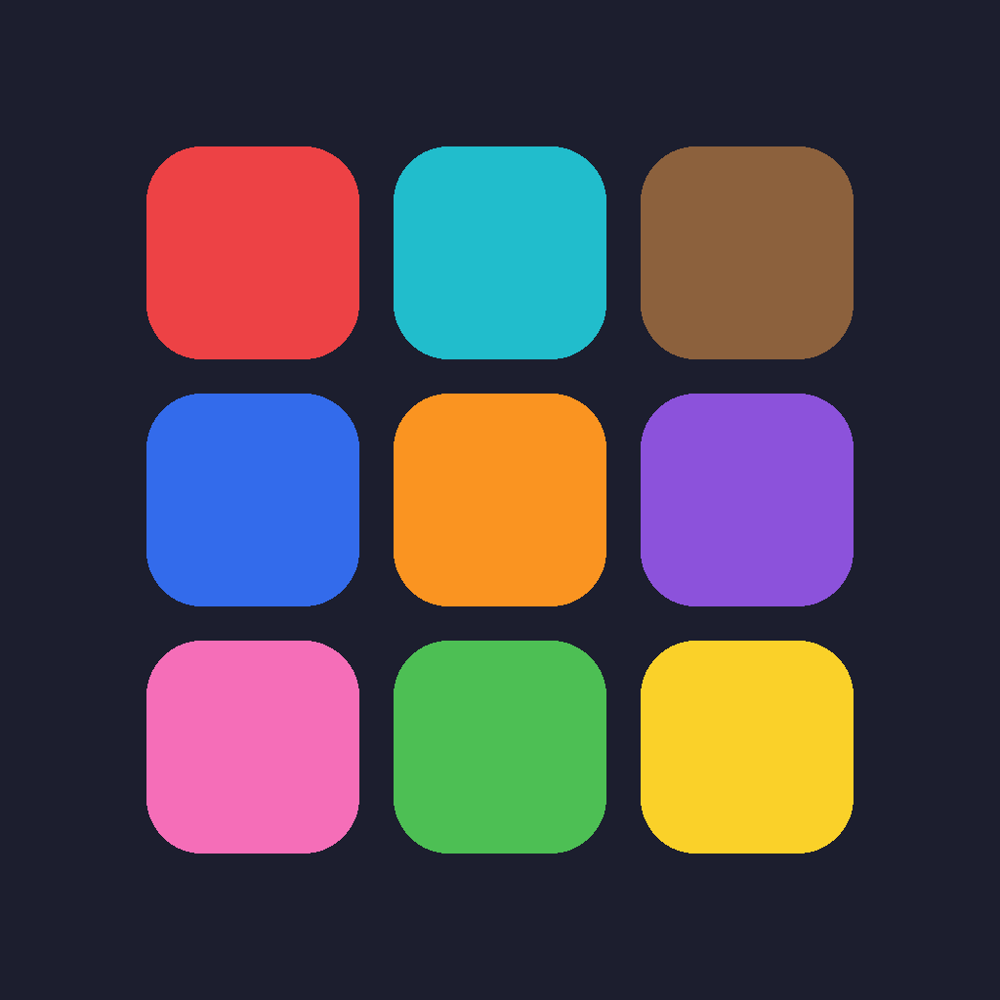

# Color Sudoku (iOS)

A sudoku game played with **colors instead of numbers**, built with SwiftUI. Free with ads, plus a
one-time **Remove Ads** in-app purchase that turns ads off for good.



## Features

- **Endless puzzles**: every puzzle is generated on the device and has exactly one solution.
  Four levels: Easy, Medium, Hard, Expert.
- **Colors as values**: fill each row, column and 3×3 box with all nine colors. Starting colors
  are rounded squares, and the colors you place are circles.
- **Color-blind friendly**: you can show a shape (●▲■★♥◆⬢☾⚡) or a number on every color.
- **Notes mode** for pencil marks (small colored dots). Placing a color clears matching notes from
  its row, column and box.
- **Undo, Erase, Hint**, mistake counter, timer, and highlighting of matching colors, the selected
  row/column/box and mistakes. Each assist can be turned on or off.
- **Auto-save**: leave at any time and continue later. The timer pauses in the background.
- **Statistics** for each difficulty: games played and won, win rate, best and average time,
  perfect games and streaks.
- **Haptics**, Dark Mode, iPhone and iPad, VoiceOver labels on every cell.

## Monetization

| | Free | After "Remove Ads" |
|---|---|---|
| Banner at the bottom of the home and game screens | ✅ | ❌ |
| Full-screen ad after a solved puzzle (at most every 2 puzzles and 3 minutes) | ✅ | ❌ |
| Consent / tracking prompts | shown when required | never |

- **Ads**: Google AdMob (Google Mobile Ads SDK 12, using Swift Package Manager). Consent comes
  from Google's User Messaging Platform (GDPR and US state privacy rules), then Apple's App
  Tracking Transparency prompt.
- **Remove Ads**: a StoreKit 2 **non-consumable** purchase (`com.example.colorsudoku.removeads`).
  - It stays forever and is restored on reinstall or on a new device. **Restore Purchases** is in
    Settings, which App Review requires.
  - Family Sharing is enabled.
  - Transactions are verified, and refunds or revocations bring the ads back.
  - The result is cached on the device, so a paying user never sees an ad, even offline or at launch.
  - If the user has paid, the ads SDK is never started.
- You can buy it from the home screen, the win screen and Settings.

## Project layout

```
ColorSudoku.xcodeproj         Xcode project (Xcode 16+, folder-synced: drop new files into ColorSudoku/)
ColorSudoku.storekit          Local StoreKit config so Remove Ads can be bought in the simulator
ColorSudoku/
  Core/                       Pure game logic, no UI (solver, generator, game state, stats)
  App/                        App entry point, view model, settings, palette, haptics
  Views/                      Home, game board, settings, statistics
  Monetization/               StoreManager (StoreKit 2), AdsManager + BannerAdView (AdMob/UMP)
  Info.plist                  AdMob app ID, SKAdNetwork IDs, tracking prompt text
  PrivacyInfo.xcprivacy       Privacy manifest
Package.swift + Tests/        Run `swift test` to test the game logic (macOS or Linux)
project.yml                   Optional XcodeGen spec that regenerates the .xcodeproj
```

## Running it

1. Open `ColorSudoku.xcodeproj` in Xcode 16 or newer. Xcode fetches the Google Mobile Ads and UMP
   packages.
2. Choose your team under *Signing & Capabilities* and change the bundle ID from
   `com.example.colorsudoku`.
3. Run on a simulator or device.
   - Ads use **Google's test IDs**, so you'll see "Test Ad" banners.
   - The scheme uses `ColorSudoku.storekit`, so you can test **Remove Ads** in the simulator
     without App Store Connect. If the purchase button shows no price, set it under
     *Product › Scheme › Edit Scheme › Run › Options › StoreKit Configuration*.

Game-logic tests: `swift test` (also runs in GitHub Actions).

## Before releasing to the App Store

1. **AdMob**: create an app and two ad units (an *Adaptive banner* and an *Interstitial*) at
   [admob.google.com](https://admob.google.com).
   - Put the app ID in `GADApplicationIdentifier` in `ColorSudoku/Info.plist`.
   - Put the unit IDs in `AdConfig` in `ColorSudoku/Monetization/AdsManager.swift`.
   - Add Google's full [SKAdNetwork list](https://developers.google.com/admob/ios/quick-start#update_your_infoplist)
     to `Info.plist`.
2. **Privacy messages**: in AdMob, go to *Privacy & messaging*. Create a GDPR message, and
   optionally a US states message and an IDFA explainer message.
3. **In-app purchase**: in App Store Connect, create a **Non-Consumable** with the ID you put in
   `StoreManager.removeAdsProductID`. Update the matching product in `ColorSudoku.storekit` too.
4. **App privacy label**: declare the data the Google Mobile Ads SDK collects (it ships its own
   privacy manifest). Also mark "Used for tracking" if you keep the App Tracking Transparency
   prompt.
5. Bump `MARKETING_VERSION` / `CURRENT_PROJECT_VERSION`, archive, and upload.

## Tuning

- Ad frequency: `AdConfig.puzzlesBetweenInterstitials`, `AdConfig.minimumSecondsBetweenInterstitials`.
- Clue counts for each difficulty: `Difficulty.targetClues` in `ColorSudoku/Core/Sudoku.swift`.
- Colors, names and shapes: `Palette` in `ColorSudoku/App/Settings.swift`.
